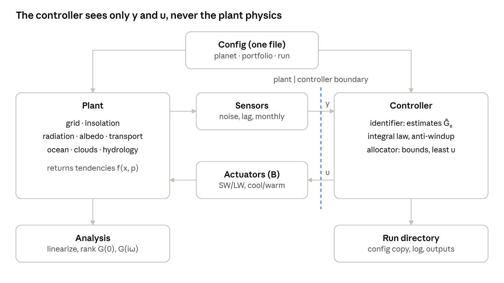

<!-- Snapshot of the Toy Planet II design doc (https://claude.ai/artifact/DMLLoH6CpcNcMfu9HqkTr4).
     The doc is the working copy; this file records each revision in Git. -->

# Toy Planet II

Design document · Oct 23, 2026 · @Greg

## Purpose and premise

Toy Planet II is a computational existence proof: across a family of planets whose physics includes unknown feedbacks, a closed-loop actuator portfolio drives the tracked climate fields to a target, except for a residual that is explicitly characterized. It is not a prediction of Earth's response, and it ignores cost by design.

**The objection it answers.** "We don't understand the climate well enough to intervene." Toy Planet II shows that understanding is not the requirement. The requirements are observability, enough independent actuator channels, and a stable feedback loop. Each can be stated, computed and checked.

**The premise, in Greg's words.** For any distribution of boundary and dynamical conditions, there is an SAI/MCB/other distributional solution that reproduces the target distribution.

**Positions settled before this design (Oct 2026 discussion):**

- Heat stored in the deep ocean does not create an unreachable region. The two-box model has controllability rank 2, so the stored heat is drained through the surface at a cost in actuation.
- With mixed-sign actuators (cooling and warming), the reachable set is the whole space, not a cone.
- Observability is a requirement met by instrumenting the atmosphere and ocean, not an objection.
- No proof exists of an unreachable region for physical fields such as temperature, precipitation and ocean heat. Only absorbing states (extinctions) are excluded.
- Sea level is to be stabilized, not reversed.

**What remains open** is magnitude, rate and side effects, plus the conditions in the next section. Toy Planet II turns each into a number.

This model is the computational backbone of §8 ("The existence proof") of *Adaptive Planetary Radiative Management, v2*. It is also a general test bench for claims about how intervention would work. Any claim is translated into the model as a planet variant (a change to the physics f) or an actuator property (a change to B), then run through the same experiments. The first such claim, which prompted this redesign, is Jan's: that a strong low-cloud feedback makes warming hard to reverse. It is an example, not the target.

## Stage-1 objectives

The first job of Toy Planet II is narrower than full climate control: to answer the claim that even a small, short SAI test could cause instantaneous, irreversible or catastrophic change. These results come first; the full-control programme follows.

**What the claim requires.** For a small forcing to cause large, lasting change, the climate must have either a discontinuity (a small forcing gives a large response) or a threshold with hysteresis within reach of the test (crossing it is not undone by removing the forcing). Toy Planet II computes, for any planet in the family, the distance to the nearest threshold in W/m² along each actuator's direction.

**First quantitative example.** In the North (1981) benchmark reproduced in phase 1, irreversible cooling (the snowball) requires lowering solar input by about 12%, roughly 40 W/m². Test-scale SAI forcing is of order 0.01 to 0.1 W/m², about 400 to 4,000 times smaller.

**The volcanic-record constraint.** A model cannot prove that Earth has no nearby threshold; a critic can always say the mechanism is missing. The argument is therefore built the other way round: any adversarial planet proposed must also survive the historical volcanic forcing record (Pinatubo: about −3 to −4 W/m² for two years) without tipping. A planet with a threshold close enough for a test to cross would already have crossed it. The critic must then name a mechanism that tips under a deliberate 0.1 W/m² but not under 3 W/m² of volcanic forcing.

| Stage-1 claim | Experiment | Run length |
| --- | --- | --- |
| Response is proportional at small dose | Response versus dose; departure from linearity | 1–10 yr |
| Reversible | Switch injection on, then off; time to recover | 1–5 yr |
| Far from thresholds | Distance to the nearest threshold along each actuator's direction | Equilibrium analysis |
| Detectable and controllable | Ramp against natural variability; time to detect, ability to hold | 1–30 yr |
| Robust to adversarial planets | Claim tests, each constrained by the volcanic record | 1–30 yr |

**Scope.** These experiments answer the physical claims of catastrophe. They do not address governance, consent, precedent, or the effects of full-scale deployment, which no climate model can settle. Each result is reported as a one-page result card: the claim as stated, how it was encoded, the result with its figure, and its limits.

**Run lengths** are 1 to 30 years. The deep ocean stays in the model because it sets the slow drift and the starting state; processes on centennial and longer timescales (ice sheets, carbon cycle) are out of scope.

## The three results

The premise holds if three results hold, in increasing order of difficulty: reachability, output tracking, and robustness to unknown physics. Toy Planet II computes each one and reports where it fails.

The planet is written as

```math
\dot{x} = f(x, p) + B(x, t)\,u, \qquad y = C x
```

where x is the climate state (band temperatures, deep-ocean temperatures, moisture), p the planet parameters, f all the physics including feedbacks the controller does not know, u the actuator settings, B(x, t) the map from actuators to forcing, and y the tracked outputs.

### 1. Reachability (state controllability)

Linearize about an operating state: A = ∂f/∂x. The linear system can reach any state if

```math
\operatorname{rank}\,[\,B,\; AB,\; A^{2}B,\; \dots,\; A^{n-1}B\,] = n
```

Controllability of the linearization implies local controllability of the nonlinear planet. Global questions (bistable regions) use nonlinear accessibility (Lie brackets) and direct simulation. This result is expected to hold; the model confirms it numerically for each planet and portfolio.

### 2. Output tracking (right-invertibility)

Holding p outputs on target trajectories at once requires the transfer matrix from actuators to outputs to have rank p at every frequency being tracked:

```math
G(s) = C\,(sI - A)^{-1} B, \qquad \operatorname{rank}\, G(i\omega) = p \quad \text{for } \omega \in \{0,\ 2\pi/\text{yr}\}
```

The steady-state test (ω = 0) is not enough for seasonal targets. Shortwave actuators scale with insolation, which is zero in polar night, so a shortwave-only portfolio can have full rank at ω = 0 and lose it at the seasonal frequency. Adding a longwave channel (cirrus thinning) is the expected remedy. Two further limits enter here: transmission zeros in the right half-plane, which bound how fast a target can be tracked, and actuator bounds such as |uₖ| ≤ uₖ,max(x, t).

### 3. Robustness to unknown physics

The controller never sees f. It works from an estimate Ĝ₀ of the steady-state gain matrix G(0) and applies integral action. For a stable plant and slow enough integral gain, the closed loop is stable when

```math
\operatorname{Re}\,\lambda_i\!\left( G(0)\,\hat{G}_0^{-1} \right) > 0 \quad \text{for all } i
```

With one input and one output this reduces to knowing the sign of the actuator's effect. With many it does not: correct signs on every channel do not guarantee stability, because errors in the cross-coupling terms matter. The tolerance to error in Ĝ₀ is therefore large but finite, and computable. The scaling ramp in the v2 framework is the procedure that brings Ĝ₀ inside that tolerance before authority is raised.

### The deliverable: the residual

Every target output the controller fails to reach is assigned a cause:

| Cause | Test that detects it | Remedy |
| --- | --- | --- |
| Rank deficiency | rank G(iω) < p | Add an independent actuator channel |
| Actuator saturation | uₖ at its bound while error persists | More authority, or a slower trajectory |
| Rate limit | Right-half-plane zeros, slow modes | Accept a slower trajectory |
| Bistability beyond authority | No recovery within bounds | Larger transient authority (go colder for longer) |
| Model mismatch | Eigenvalue condition violated | Re-identify Ĝ₀ |

## Model physics

The plant is a seasonal, zonal-mean moist energy-balance model: N latitude bands, each with a surface layer and a deep-ocean layer, coupled by diffusion of moist static energy. It is the simplest model in which all three results can be posed.

**Grid.** N bands of equal area (uniform in sin φ), N = 36 by default and configurable from 9 to 90. Band edges sit at sin φ = k/N; any N divisible by 4 places an edge exactly at ±30°, which N = 36 does. Edges are not otherwise aligned with circulation-cell boundaries: those move with season, with warming and across the planet family, so they are represented in the transport and actuator physics, and diagnosed as outputs, not fixed in the grid. Each band has a land fraction from the config, which sets its heat capacity and where MCB can act.

**Equations, per band:**

```math
C(\phi)\,\frac{\partial T}{\partial t} = Q(\phi,t)\,[1-\alpha(T,\phi)] - (A + B_{\mathrm{OLR}} T) + \frac{1}{\cos\phi}\frac{\partial}{\partial \phi}\!\left(\cos\phi\, \frac{D}{a^2}\frac{\partial h}{\partial \phi}\right) - \gamma (T - T_d) + F_{\mathrm{GHG}} + \sum_k B_k(\phi,t)\,u_k
```

```math
C_d\,\frac{\partial T_d}{\partial t} = \gamma\,(T - T_d), \qquad h = c_p T + L\,r\,q^{*}(T)
```

| Term | Form | Notes |
| --- | --- | --- |
| Insolation Q(φ, t) | Daily-mean from orbital geometry | Seasonal cycle; obliquity is a planet parameter |
| Albedo α(T, φ) | Smooth: α_ice + (α_free − α_ice) · ½\[1 + tanh((T − T_f)/ΔT)\] | A tanh, not a step, so the loop does not chatter; set on absolute T |
| Outgoing longwave | A + B_OLR T (Budyko) | B_OLR is the local feedback parameter, swept across the planet family |
| Transport | Diffusion of moist static energy h | Latent part gives P − E per band; r = relative humidity. Optional latitude-dependent D(x), with regime boundaries (Hadley edge, polar front) as planet parameters |
| Deep ocean | Two-layer, exchange γ | The deep-ocean case from the Oct 2026 discussion, in every band |
| GHG forcing | 5.35 ln(C/C₀) W/m² | Longwave: uniform in latitude, day and night, all seasons |
| Low-cloud feedback | Cloud reflectivity as a function of SST; switchable, including a bistable form | Test case for cloud-feedback claims (first: Jan's); off by default |

**Actuator states.** Each SAI channel adds a burden state (and a conversion state for species that need one) to x, so the plant has 2N + K to 2N + 2K states for N bands and K SAI channels. Their equations are in the Actuators section.

**Outputs** are band temperature, P − E per band, ice-edge latitude, the energy-flux equator (the latitude of zero northward atmospheric energy transport, a proxy for the ITCZ), and the three large-scale modes used in the GLENS work (global mean, interhemispheric gradient, equator-to-pole gradient), so results can be compared with that literature.

**Numerics.** Diffusion is integrated implicitly (backward Euler or Crank–Nicolson), the rest explicitly, with a time step of about one day. The reason: explicit diffusion on a fine grid is only stable for steps shorter than roughly Δx²/2D, which would force tiny steps. Treating the stiff term implicitly removes that limit. A 100-year run at N = 36 should take seconds.

**Known gap.** A 1-D moist EBM does not represent the fast precipitation response that makes shortwave and longwave forcing differ (Bala et al. 2008): global-mean precipitation is set by atmospheric radiative cooling, which the two forcing types change differently. Closing that gap needs a separate atmospheric energy budget per band. It is deferred to phase 6 and listed under open questions.

## Actuators and the B matrix

Each actuator is a column of B: the forcing pattern, in W/m² per band, produced by one unit of that actuator. The portfolio spans both spectral channels and both signs, because the rank and cone arguments depend on it.

| Actuator | Channel | Sign | Spatial pattern | Authority bound |
| --- | --- | --- | --- | --- |
| SAI at injection latitude φᵢ | Shortwave | Cooling | Spread around φᵢ by stratospheric transport, shaped by the transport barriers (tropical-pipe edges near ±20°, polar-vortex edge near 60°, both planet parameters); scaled by local insolation | Fraction of absorbed sunlight; optional sublinear dose response |
| MCB per band | Shortwave | Cooling | Ocean fraction of the band only | Fraction of absorbed sunlight over ocean |
| Cirrus thinning per band | Longwave | Cooling | Local; acts at night and in polar winter | Fixed W/m² cap |
| Absorbing aerosol / cirrus seeding per band | Shortwave or longwave | Warming | Local | Fixed W/m² cap |

**Injection sites are a free set.** The injection field is represented on a finite basis:

```math
I(\phi, \lambda, t) = \sum_k u_k(t)\, \psi_k(\phi, \lambda)
```

where ψₖ is the forcing footprint of site k after stratospheric transport, and uₖ(t) is its injection rate, reset at each control step. The number and placement of sites are config parameters with no cap. Altitude and aerosol species can be added as further indices. In 1-D a site is a latitude; longitude enters in phase 7.

**Aircraft tracks.** A track is a line source: injection along a flight path over a time window. Its footprint is the point-source kernel integrated along the path, so any track is a sum of basis contributions. In 1-D an east–west track is one latitude and a north–south track spans several bands. Tracks shorter than the plume's spreading scale behave as points, which sets the lower length limit.

**Control and flight planning are separate layers.** The controller decides the desired injection field u(t). A realization layer converts it into flight tracks under aircraft constraints: minimum track length, range, payload, altitude ceiling, sortie schedule. Any difference between the requested and the delivered field enters the plant as a disturbance, which the feedback loop corrects. Flights are discrete in time, but the aerosol lifetime (about a year) is far longer than the interval between sorties, so a monthly-aggregated rate is adequate for the plant.

**One real nonlinearity: injection density.** In a concentrated plume, particles coagulate and grow, which lowers cooling per kilogram. Radiative efficiency therefore depends on mass injected per unit track length: the same mass spread over a longer track cools more. The model carries this as an efficiency factor η(rate per km) in each SAI column, which makes B depend on u. Track length is thus a physical design variable, not only a logistical one.

### Time response of each actuator

Every actuator's forcing follows its setting through its own dynamics, so each has a usable bandwidth. For stratospheric aerosol the binding limit is removal, not chemistry.

**Aerosol species are generic.** SO₂-derived sulfate is one entry in a species library, not an assumption of the model. Each species carries its own parameters: a conversion time τ_c (about a month for SO₂; zero for direct injection of sulfuric acid or solid particles such as calcite or alumina), a removal lifetime τ_L, a radiative efficiency, and side-effect coefficients (stratospheric heating, ozone). Testing a new material means adding a library entry and running the ramp; incorporating or rejecting it is the same identification procedure the controller already uses.

**Burden dynamics, per SAI channel k:**

```math
\frac{dm_k}{dt} = s_k(t) - \frac{m_k}{\tau_L}, \qquad \frac{ds_k}{dt} = \frac{u_k(t) - s_k}{\tau_c}, \qquad F_k = -\eta_k\, m_k
```

with sₖ the conversion stage (sₖ = uₖ when τ_c = 0). τ_L depends on species (particle size and density set sedimentation), injection latitude and altitude.

**Asymmetry.** The burden rises as fast as the fleet delivers, but cannot be removed. With uₖ = 0 the forcing decays no faster than its natural rate:

```math
\frac{dF_k}{dt} \ge -\frac{F_k}{\tau_L}
```

Cooling can be added fast and taken back only slowly, unless a warming actuator is available to offset it.

**Attenuation of fast variation.** A sinusoidal injection at frequency ω produces forcing reduced by 1/√(1 + (ωτ_L)²) and lagging by arctan(ωτ_L). Because uₖ ≥ 0, this caps the seasonal swing one injector can produce:

| Removal lifetime τ_L | Attenuation at 1/yr | Phase lag | Maximum seasonal forcing swing |
| --- | --- | --- | --- |
| 12 months | 0.16 | 81° (about 2.7 months) | ±16% of its mean |
| 6 months | 0.30 | 72° | ±30% |
| 4 months | 0.43 | 64° | ±43% |

Shortwave actuators also get seasonal variation free from insolation; the cap applies only to modulation beyond that. Shorter-lived species buy bandwidth at the cost of more mass to sustain the same forcing; the planet-family sweep can trade the two.

**Speed by actuator type:**

| Actuator | Forcing response time | Role |
| --- | --- | --- |
| SAI | Set by τ_c and τ_L of the species | Baseline; limited seasonal shaping |
| MCB | About a day | Seasonal and sub-seasonal shaping; daylight only |
| Cirrus thinning | Hours to days | Seasonal shaping, including polar night |
| Absorbing aerosol | Days to weeks (troposphere); species-dependent (stratosphere) | Warming offset |

The portfolio therefore divides by speed: slow SAI carries the baseline, fast tropospheric actuators handle seasonal shaping and offset SAI's slow decay. This is the multi-rate structure in the v2 framework, and it bears on result 2: SAI's attenuation lowers the seasonal rank of an SAI-only portfolio, and the fast actuators restore it.

Lifetimes quoted are approximate published values, not yet checked against sources.

**Each uₖ is non-negative.** Mixed sign comes from pairing a cooling and a warming actuator in the same place, which is how the physical system works.

**B is periodic in time.** A shortwave column is proportional to Q(φ, t)\[1 − α\], so it varies through the year and vanishes in polar night. The seasonal rank test in result 2 is therefore a question about a periodic system. Two ways to answer it: harmonic transfer functions (the frequency-domain method for periodic systems), or brute force, by simulating a seasonal target and checking the residual. Phase 6 does both and compares them.

**Comparison point.** GLENS used four SAI injection latitudes (30°N, 15°N, 15°S, 30°S) against three targets. That configuration is one row of the portfolio sweep, so Toy Planet II can reproduce it and then show what changes as actuators are added.

## Controller design

The controller is a multi-input integral controller that sees only noisy outputs y and sets u. It never reads the plant's equations or parameters, and the software enforces that separation.

**Control law.** With tracking error e = y − r:

```math
u = \Pi_{\mathcal{U}}\Big[\, u_{\mathrm{ff}} - K_P\, e - K_I \int e\, dt \,\Big], \qquad K_I = k_I\, \hat{G}_0^{+}
```

where Ĝ₀⁺ is the pseudo-inverse of the estimated gain matrix and Π projects onto the allowed actuator set (bounds, uₖ ≥ 0).

**Over-actuation.** When there are more actuators than tracked outputs, many u give the same y. The allocator picks one by a secondary objective: minimum total actuation, or minimum side-effect outputs. This is the "multiple solutions" property of an over-constrained system, made explicit.

**Saturation.** Integration pauses on any channel held at its bound (anti-windup), so the controller responds at once when the bound releases. Toy Planet I lacked this.

**Up/down asymmetry.** Stratospheric cooling cannot be withdrawn faster than its removal lifetime. The controller therefore carries a predictive term that limits overshoot in cooling, and routes fast corrections, in either direction, to the fast tropospheric actuators. Runs log how often each injector sits at zero and how often the decay limit binds.

**Identification.** Ĝ₀ is estimated from small actuator perturbations and the measured response, the computational version of the scaling ramp. It can be refreshed during a run.

**Measurement.** Control updates monthly. Sensors add configurable noise and lag. Natural variability enters as red-noise forcing, so detectability of small signals is part of every run.

**Later, if needed:** model-predictive control over a short receding horizon, to handle bounds and rate limits directly rather than by projection.

## Planet family and the decisive experiment

The decisive experiment designs the controller on one planet and runs it unchanged on others. Success across a broad family shifts the burden to the skeptic: show why Earth is the member on which feedback control fails.

**Parameters swept** (ranges to be set in phase 6; the first two rows are standard published values as a starting point):

| Parameter | Symbol | Starting range |
| --- | --- | --- |
| Local radiative feedback | B_OLR | 0.8 to 2.5 W m⁻² K⁻¹ |
| Mixed-layer heat capacity | C | 4 to 16 W yr m⁻² K⁻¹ |
| Deep-ocean heat capacity, exchange | C_d, γ | To be set |
| Transport strength | D | To be set |
| Ice albedo, freezing threshold | α_ice, T_f | To be set |
| Land fraction by band | — | Earth-like to aquaplanet |
| Low-cloud feedback strength | — | Off, strong, bistable |
| Obliquity, solar constant | — | To be set |
| Greenhouse forcing | F_GHG | 0 to 8 W/m² |

**Experiments:**

1. **Rank census.** For each actuator portfolio and each planet, compute rank G(0) and rank G(iω_yr) against the tracked outputs. This is the counting condition in numbers.
2. **Nominal tracking.** The controller is identified on the planet it runs on. Confirms results 1 and 2 in closed loop.
3. **Mismatch (decisive).** Ĝ₀ from planet A, run on planet B. Map success and failure against the eigenvalue condition of result 3, then compare the predicted boundary with the simulated one.
4. **Claim tests.** Each claim is encoded as a planet variant or actuator property and run through experiments 1 to 3. Report whether the target is recovered within actuator bounds, how long it takes, and which residual cause applies if not. The first case is a strong and bistable low-cloud feedback (Jan's claim).
5. **Ramp.** Authority starts small and grows while Ĝ₀ is re-identified. Tests the v2 framework's development sequence.
6. **Kernel sweep (the degrees-of-freedom question).** Vary the stratospheric spreading width and aerosol lifetime. For each setting, add injection sites one at a time and record the effective rank of B (the number of singular values above the noise floor). A narrow kernel lets each site add an independent forcing pattern, which is Greg's argument that injection outpaces dispersion. A broad kernel makes extra sites redundant, adding no rank, which is the low-DOF result of the MacMartin lineage. The curve shows which regime holds for given transport parameters.

**Success criterion (proposed):** band annual-mean temperature within 0.1 K of target after the transient, and P − E within a tolerance to be set in phase 6. Any miss is classified using the residual table in the three-results section.

## Software architecture

The code is a Python package in which the plant and the controller share nothing except the measured outputs y and the actuator settings u. That boundary is what makes the "despite unknown physics" claim honest: the controller cannot use what it is not given.



The loop runs plant → sensors → controller → actuators → plant; analysis reads the plant directly for the rank tests, and every run writes its own record.

**Package layout:**

```
toyplanet/
  config/        planet.toml, portfolio.toml, experiment.toml
  grid.py        bands, areas; an interface so 2-D can replace it
  insolation.py  daily-mean Q(phi, t)
  physics/       radiation, albedo, transport, ocean, clouds, hydrology
  plant.py       assembles tendencies; the only place physics is combined
  actuators.py   builds the columns of B
  sensors.py     noise, lag, sampling
  controller/    identify.py, integral.py, allocate.py, realize.py (field to flight tracks)
  analysis/      linearize.py, rank.py, residual.py
  run.py         one entry point: reads config, writes a run directory
tests/           one test file per module, plus end-to-end runs
```

**Rules, and the reason for each:**

- *Physics as pure functions:* each takes the state and parameters and returns a tendency, with no hidden state. A function that behaves the same every call can be tested alone and swapped without touching the rest.
- *Nothing runs on import:* importing a module only defines things. This prevents the Toy Planet I failure, where an import ran a whole simulation.
- *One config, validated:* every parameter lives in the config files, checked against a schema at start-up. A misspelled or unused key stops the run instead of being silently ignored.
- *The grid is an interface:* physics asks the grid for areas and gradients, never assumes latitude bands. The 2-D model then needs a new grid object and transport operator, not a rewrite.
- *Every run leaves a record:* a time-stamped directory holding a copy of the config, a log of what ran, and the outputs. Any result can be traced to its exact inputs.
- *Tests define done:* energy conservation, known analytic solutions, two-box rank = 2, and closed-loop error reduction.

**Tools:** Python 3, NumPy, SciPy, matplotlib; xarray optional for labeled output. All of it runs on a laptop.

## Phase plan

Stage-1 results come first (phases 2 to 5), then the full-control programme (phase 6), then 2-D (phase 7). Each phase ends at a gate that must pass before the next begins. Revised 2026-10-24 to put stage-1 objectives first.

1. **Seasonal energy-balance plant.** N bands, implicit diffusion, smooth ice albedo, two-layer ocean, GHG forcing. *Built.*
   - Gate met: energy budget closes to round-off; the linear planet matches its directly solved steady state; the North (1981) ice-edge benchmark is reproduced, including the snowball bifurcation and hysteresis. Remaining: one light seasonal calibration pass (mixed-layer response time, seasonal range, ice edge).
2. **Stage-1 plant inputs.** Natural variability as red-noise forcing; prescribed volcanic forcing (single pulses and a historical record).
   - Gate: the response to a Pinatubo-like pulse is comparable to the observed cooling and recovery.
3. **One SAI actuator, termination and dose response.** A single actuator with burden dynamics (aerosol lifetime).
   - Gate: departure from linearity at test-scale doses quantified; recovery time after termination reported.
4. **Detectability, threshold distance and adversarial planets.** Time for a test of given strength to rise above natural variability; distance to the nearest threshold; claim tests constrained by the volcanic record.
   - Gate: a result card for each stage-1 claim.
5. **Single-loop controller.** Integral control of global-mean temperature, with the ramp, under natural variability and sensor noise.
   - Gate: holds the target within tolerance; closed loop reduces error.
6. **Full-control programme.** Multiple actuators and the B matrix, rank of G(0) and G(iω_yr), the multi-input controller and mismatch tests, water and clouds, the planet-family sweep and residual map.
   - Gate: the residual map, with each miss classified by cause.
7. **2-D (latitude–longitude).** Separates land from ocean, places MCB regionally, and allows regional precipitation targets such as monsoons.
   - Gate: phase 6 results recomputed on the 2-D grid; the change in rank with longitude resolution reported.

**Why 2-D comes later rather than never.** A zonal mean cannot represent a regional target such as a monsoon or a land–sea contrast, so the regional version of the premise needs 2-D. The physics and controller code carry over unchanged if the grid is an interface rather than an assumption; only the transport operator and the grid object change. Compute is not the constraint: a 2-D energy-balance model on a 64 × 32 grid still runs in minutes on a laptop. The constraint is validation effort.

## Lessons from Toy Planet I

Toy Planet I (June 2025, built with ChatGPT) had sound two-layer physics but could not test the premise. Each defect maps to a rule here.

| Toy Planet I defect | Rule in Toy Planet II |
| --- | --- |
| Controller sign inverted: cooled when too cold | Every controller test checks that closed loop reduces error |
| Controller, albedo and carbon modules never called | An integration test runs the full driver on every change |
| A script imported as a module ran its own simulation | No side effects on import; physics as pure functions |
| Config key `carbon_scenario` silently ignored; parameters hard-coded twice | Config validated against a schema; unknown or unused keys are errors |
| Forcing switched on as a 2.45 W/m² step at the first year | Every run starts from a spun-up equilibrium |
| One global temperature, one actuator | Spatial bands from phase 1; a multi-column B in phase 6 |

## Open questions

- [ ] Precipitation gap: add a per-band atmospheric energy budget in phase 6, or accept the 1-D moist EBM's limit and defer to 2-D?
- [ ] Seasonal rank: is the harmonic-transfer-function method worth implementing, or is brute-force simulation sufficient?
- [ ] For each claim tested, what functional form and strength does it assume? First up: Jan's low-cloud feedback.
- [ ] Success tolerances for P − E and for seasonal (not just annual-mean) targets.
- [ ] Amplitude and redness of the natural-variability forcing.
- [ ] Diurnal cycle: out of scope for a daily-mean model; state as a limitation or plan a sub-daily variant?

## References

- Slater, G., *Adaptive Planetary Radiative Management, v2* (July 2026), §8
- Held, I. M., et al. (2010), Probing the fast and slow components of global warming by returning abruptly to preindustrial forcing, *J. Climate* (two-layer model)
- North, G. R., Cahalan, R. F., Coakley, J. A. (1981), Energy balance climate models, *Rev. Geophys.*
- Frierson, D. M. W., Held, I. M., Zurita-Gotor, P. (2007), A gray-radiation aquaplanet moist GCM, *J. Atmos. Sci.* (moist static energy diffusion); Hwang, Y.-T., Frierson, D. M. W. (2010), *Geophys. Res. Lett.*
- Bala, G., Duffy, P. B., Taylor, K. E. (2008), Impact of geoengineering schemes on the global hydrological cycle, *PNAS*
- Kravitz, B., et al. (2017), First simulations of designing stratospheric sulfate aerosol geoengineering to meet multiple simultaneous climate objectives, *J. Geophys. Res.*; Tilmes, S., et al. (2018), the GLENS project, *Bull. Amer. Meteor. Soc.*
- MacMartin, D. G., et al. (2014), Dynamics of the coupled human–climate system resulting from closed-loop control of solar geoengineering, *Climate Dynamics*
- Davison, E. J. (1976), The robust control of a servomechanism problem for linear time-invariant multivariable systems, *IEEE Trans. Automatic Control*
- Claude discussions: [Toy Planet origin, June 2025](https://claude.ai/chat/ee79101a-4875-4990-9444-0f21e86bf50f) · [Framework v1 and v2, July 2026](https://claude.ai/chat/64748e7c-c9d8-4bab-bd1e-2a415739ecb7) · [Underactuation critique, Aug 2026](https://claude.ai/chat/94fdea32-9465-4c8e-9b46-f3d55efa2227) · [FaIR and the controllability argument, Feb 2026](https://claude.ai/chat/cbc83aeb-95fe-4ba9-be28-1ddbee4a0a66)

Citations are from memory and not yet checked against the papers.
